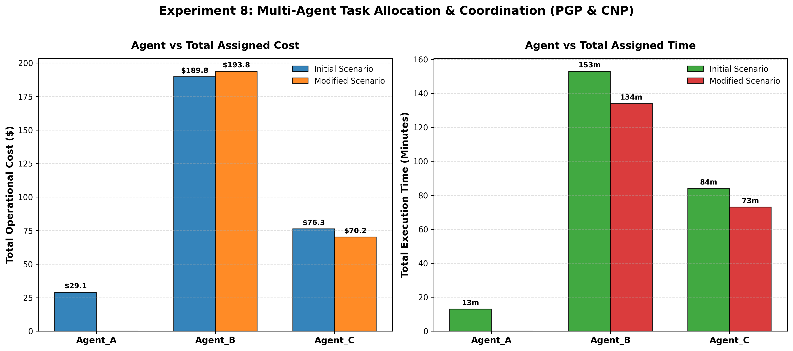

# AI401 — Expert Systems Lab
## Experiment 8 / Lab 8: Multi-Agent Task Allocation and Coordination

---

### **Aim**
To implement a simple multi-agent task allocation system using **Partial Global Planning (PGP)** and the **Contract Net Protocol (CNP)** in Python, resolve spatial-temporal resource conflicts among autonomous agents, dynamically allocate multiple heterogeneous tasks via competitive bidding, and evaluate system sensitivity under modified operational parameters.

---

### **Theoretical Foundations**

#### **1. Multi-Agent Systems (MAS)**
A Multi-Agent System consists of multiple autonomous, computational entities (agents) situated in a shared environment. Each agent possesses:
- **Autonomy**: Ability to make independent decisions based on local goals.
- **Social Ability**: Capability to negotiate, coordinate, and communicate using standard protocols.
- **Reactivity & Proactiveness**: Perceiving changes in the environment and taking goal-directed initiatives.

#### **2. Partial Global Planning (PGP)**
Developed by Durfee and Lesser (1987), Partial Global Planning addresses the challenge of distributed coordination without requiring a bottlenecked centralized controller or full global state synchronization.
- **Local Plans**: Individual agents maintain plans to achieve their assigned tasks over time.
- **Partial Global View (PGV)**: Agents communicate summaries of their planned actions, scheduled resource reservations, and temporal intervals to a coordination node or peer agents.
- **Conflict Detection**: The coordinator identifies spatial-temporal contentions:
  $$\text{Overlap}(A_i, A_j) = \max\left(0, \min(E_i, E_j) - \max(S_i, S_j)\right) > 0$$
  where $[S_i, E_i]$ and $[S_j, E_j]$ denote the planned time windows of agent $i$ and $j$ on a shared single-capacity resource.
- **Deconfliction Strategy**: Local schedules are revised based on domain heuristics (e.g., priority ranking, task deadlines, or diversion to secondary resources), restoring global execution coherence.

#### **3. Contract Net Protocol (CNP)**
Originally formulated by Reid G. Smith (1980) and standardized by FIPA (Foundation for Intelligent Physical Agents), the Contract Net Protocol models distributed problem solving as a market-like contracting process:
1. **Task Announcement (Call For Proposals - CFP)**: The Manager Agent broadcasts an announcement detailing task specifications (payload, deadline, distance, priority).
2. **Bidding (Proposals)**: Eligible Delivery Agents evaluate local feasibility (payload capacity, speed, range) and calculate a bid cost $C_i$ and estimated completion time $T_i$:
   $$C_i = \text{BaseCost}_i + (\text{Distance} \times \text{Rate}_i) + (0.5 \times \text{Weight})$$
3. **Bid Evaluation**: The Manager collects proposals, verifies constraints, and ranks candidates according to an objective function (e.g., $\min(C_i)$ with tie-breaking on $T_i$).
4. **Agent Selection & Award**: The Manager sends an `ACCEPT-PROPOSAL` message to the winning bidder and `REJECT-PROPOSAL` messages to the rest.
5. **Contract Confirmation**: The chosen agent commits the task into its internal schedule and returns an acknowledgment (`INFORM-DONE`).

---

### **System Architecture & Specifications**

#### **1. Agent Specifications**
| Agent ID | Agent Role | Vehicle Type | Base Cost ($) | Cost / km ($) | Speed (km/h) | Max Payload (kg) | Fixed Handling |
| :--- | :--- | :--- | :--- | :--- | :--- | :--- | :--- |
| **`Manager_Central`** | Coordinator / Manager | Dispatch Hub | — | — | — | — | — |
| **`Agent_A`** | Delivery Contractor | Express Drone | $15.00 | $1.80 | 60.0 | 10.0 kg | 5 min |
| **`Agent_B`** | Delivery Contractor | Electric Courier Van | $20.00 | $1.20 | 40.0 | 30.0 kg | 12 min |
| **`Agent_C`** | Delivery Contractor | Heavy Cargo Truck | $30.00 | $0.90 | 30.0 | 50.0 kg | 20 min |

#### **2. Task Specifications**
| Task ID | Task Description | Destination | Distance (km) | Payload (kg) | Deadline (min) | Priority Level |
| :--- | :--- | :--- | :--- | :--- | :--- | :--- |
| **`T1`** | Urgent Medical Supplies | City General Hospital | 12.0 km | 3.5 kg | 30 min | **P1 (Critical)** |
| **`T2`** | Bulk Grocery Consignment | Downtown Community Hub | 18.0 km | 28.0 kg | 90 min | **P3 (Standard)** |
| **`T3`** | Electronics & Microchips | Silicon Tech Corridor | 25.0 km | 8.0 kg | 60 min | **P2 (High)** |
| **`T4`** | Confidential Legal Dossier | High Court Precinct | 7.5 km | 1.2 kg | 45 min | **P1 (Critical)** |
| **`T5`** | Heavy Machinery Spare | Eastern Industrial Port | 32.0 km | 35.0 kg | 120 min | **P3 (Standard)** |
| **`T6`** | Retail Apparel Packages | Metro Mall Distribution | 15.0 km | 12.0 kg | 75 min | **P2 (High)** |

---

### **Experimental Implementation & Results**

#### **Exercise 1: Agent Setup & Evaluation Matrix**

Evaluating feasibility, operational cost, and transit time across all agent-task pairs:

| Task ID | `Agent_A` (Express Drone) | `Agent_B` (Electric Van) | `Agent_C` (Heavy Truck) | Feasibility Notes |
| :--- | :--- | :--- | :--- | :--- |
| **`T1`** | $38.35 / 17 min | **$36.15 / 30 min** | `INFEASIBLE` | Exceeds deadline for Agent C (35 min > 30 min) |
| **`T2`** | `INFEASIBLE` | **$55.60 / 39 min** | $60.20 / 56 min | Exceeds payload for Drone (28 kg > 10 kg) |
| **`T3`** | $64.00 / 30 min | **$54.00 / 50 min** | `INFEASIBLE` | Exceeds deadline for Agent C (64 min > 60 min) |
| **`T4`** | **$29.10 / 13 min** | $29.60 / 23 min | $37.35 / 35 min | All feasible; Drone lowest cost & fastest |
| **`T5`** | `INFEASIBLE` | `INFEASIBLE` | **$76.30 / 84 min** | Exceeds payload for Drone & Van (35 kg > 30 kg) |
| **`T6`** | `INFEASIBLE` | **$44.00 / 34 min** | $49.50 / 50 min | Exceeds payload for Drone (12 kg > 10 kg) |

---

#### **Exercise 2: PGP Coordination & Deconfliction**

##### **1. Initial Local Plans (Conflict Injection)**
- **`Agent_A`** plans loading for **`T1`** at `Loading_Bay_Alpha` from **09:30 to 10:15** (45 min duration).
- **`Agent_B`** plans loading for **`T2`** at `Loading_Bay_Alpha` from **09:50 to 10:40** (50 min duration).
- **`Agent_C`** plans loading for **`T5`** at `Loading_Bay_Beta` from **10:00 to 11:00** (independent dock).

##### **2. Conflict Detection Output**
- Resource: `Loading_Bay_Alpha`
- Overlapping Agents: `Agent_A` and `Agent_B`
- Conflict Interval: **09:50 to 10:15** (25 minutes mutual contention).

##### **3. Priority-Based PGP Deconfliction Strategy**
- Priority Evaluation: $T_1$ is **P1 (Critical Medical Supplies)**, whereas $T_2$ is **P3 (Standard Bulk Groceries)**.
- **Coordination Action**: `Agent_A` retains its scheduled window [09:30 - 10:15]. `Agent_B`'s local schedule is shifted to start after `Agent_A` clears the bay with a 5-minute safety buffer: **10:20 - 11:10**.

##### **4. Final Coordinated Schedule (Post-PGP)**
| Agent ID | Task ID | Resource Name | Scheduled Window | Deconfliction Status |
| :--- | :--- | :--- | :--- | :--- |
| **`Agent_A`** | `T1` | `Loading_Bay_Alpha` | `09:30 - 10:15` | Retained (Higher Priority P1) |
| **`Agent_B`** | `T2` | `Loading_Bay_Alpha` | `10:20 - 11:10` | Rescheduled (Shifted by PGP) |
| **`Agent_C`** | `T5` | `Loading_Bay_Beta` | `10:00 - 11:00` | Unchanged (No Contention) |

*Verification:* Residual conflicts = **0**. Coherence achieved across all local agent plans.

---

#### **Exercise 3: Contract Net Protocol (CNP) Single Task Trace**

Trace of negotiation for representative Task **`T1`** (Urgent Medical Supplies):
1. **Task Announcement (CFP)**:
   - Manager broadcasts: `CFP(T1: Dest=City Hospital, Dist=12km, W=3.5kg, Deadline=30min)`.
2. **Bidding Stage**:
   - `Agent_A` submits bid: **$38.35**, Time: **17 min** (Feasible, high-speed drone).
   - `Agent_B` submits bid: **$36.15**, Time: **30 min** (Feasible, electric courier).
   - `Agent_C` refuses: Ineligible (Estimated time 35 min > 30 min deadline).
3. **Bid Comparison**:
   - Feasible bids evaluated: `Agent_B` ($36.15) vs `Agent_A` ($38.35).
   - Winner: `Agent_B` (Lowest operational cost while satisfying deadline).
4. **Agent Selection & Award**:
   - Manager sends `ACCEPT-PROPOSAL` to `Agent_B`.
   - Manager sends `REJECT-PROPOSAL` to `Agent_A`.
5. **Contract Commitment**:
   - `Agent_B` confirms assignment, commits resources, and increments cumulative workload.

---

#### **Exercise 4: Multiple Task Allocation**

Automated execution of the CNP allocation cycle across all six tasks ($T_1$ through $T_6$):

| Task ID | Task Description | Selected Agent | Awarded Cost ($) | Completion Time (min) |
| :--- | :--- | :--- | :--- | :--- |
| **`T1`** | Urgent Medical Supplies | **`Agent_B`** | $36.15 | 30 min |
| **`T2`** | Bulk Grocery Consignment | **`Agent_B`** | $55.60 | 39 min |
| **`T3`** | Electronics & Microchips | **`Agent_B`** | $54.00 | 50 min |
| **`T4`** | Confidential Legal Dossier | **`Agent_A`** | $29.10 | 13 min |
| **`T5`** | Heavy Machinery Spare | **`Agent_C`** | $76.30 | 84 min |
| **`T6`** | Retail Apparel Packages | **`Agent_B`** | $44.00 | 34 min |
| **TOTALS** | — | — | **$295.15** | **250 min** |

##### **Individual Agent Workload Summary (Initial Allocation)**
- **`Agent_A`** (Express Drone): Assigned **1 Task** (`T4`) | Cost: **$29.10** | Time: **13 min**
- **`Agent_B`** (Electric Van): Assigned **4 Tasks** (`T1, T2, T3, T6`) | Cost: **$189.75** | Time: **153 min**
- **`Agent_C`** (Cargo Truck): Assigned **1 Task** (`T5`) | Cost: **$76.30** | Time: **84 min**

---

#### **Exercise 5: Modification & Comparative Visualization**

##### **1. Parameter Modification (Scenario B)**
- **Drone Tariff Surcharge**: `Agent_A` base cost increases from $15.00 to $28.00; per-km rate increases from $1.80 to $2.20.
- **Electric Van Drivetrain Upgrade**: `Agent_B` speed increases from 40 to 55 km/h; per-km rate drops from $1.20 to $1.00; base cost drops to $18.00.
- **Green Logistics Freight Subsidy**: `Agent_C` base cost drops from $30.00 to $22.00; per-km rate drops to $0.85/km.
- **Heavy Cargo Surge**: `T5` payload increases from 35.0 kg to 42.0 kg.

##### **2. Comparative Allocation Results**

| Task ID | Initial Agent | Initial Cost ($) | Modified Agent | Modified Cost ($) | Reallocation Status |
| :--- | :--- | :--- | :--- | :--- | :--- |
| **`T1`** | `Agent_B` | $36.15 | `Agent_B` | $31.75 | No Change (Cost Reduced) |
| **`T2`** | `Agent_B` | $55.60 | `Agent_B` | $50.00 | No Change (Cost Reduced) |
| **`T3`** | `Agent_B` | $54.00 | `Agent_B` | $47.00 | No Change (Cost Reduced) |
| **`T4`** | **`Agent_A`** | $29.10 | **`Agent_B`** | **$26.10** | **SHIFTED (`Agent_A` $\rightarrow$ `Agent_B`)** |
| **`T5`** | `Agent_C` | $76.30 | `Agent_C` | $70.20 | No Change (Cost Reduced) |
| **`T6`** | `Agent_B` | $44.00 | `Agent_B` | $39.00 | No Change (Cost Reduced) |
| **TOTAL** | — | **$295.15** | — | **$264.05** | **1 Task Reallocated; $31.10 Net Savings** |

##### **3. Graphical Visualization**
The generated Matplotlib visualization compares **Agent vs Total Assigned Cost** and **Agent vs Total Assigned Time** across both scenarios:

---

### **Observations & Discussion**

1. **Conflict Resolution via Partial Global Planning (PGP)**:
   - PGP provides a resilient balance between centralized command and pure distributed anarchy. Agents do not sacrifice autonomy over non-contended planning; they only negotiate shared bottlenecks (`Loading_Bay_Alpha`).
   - Priority heuristics successfully resolve schedule contentions deterministically without starvation.

2. **Market Dynamics of Contract Net Protocol (CNP)**:
   - CNP enables decentralized task distribution without requiring the Manager to maintain exhaustive knowledge of each vehicle's real-time physical battery or engine equations.
   - Specialized capabilities naturally emerge: heavy freight (`T5`) was handled exclusively by `Agent_C` due to payload feasibility boundaries, while mid-distance tasks converged onto the cost-effective `Agent_B`.

3. **Sensitivity Analysis & Adaptive Reallocation**:
   - When drone operational tariffs increased in Scenario B, `T4` (legal documents) dynamically shifted from `Agent_A` to `Agent_B`.
   - The system adapted instantaneously to the modified cost surface, lowering the total fleet cost from **$295.15** to **$264.05** without human intervention or rule rewriting.

---

### **Conclusion**
The multi-agent system successfully modeled and executed both **Partial Global Planning** and the **Contract Net Protocol**. PGP eliminated temporal resource overlap at shared loading docks, while CNP ensured globally cost-effective, decentralized task assignments. The implementation demonstrated high adaptability, modularity, and responsiveness under varying operational and environmental constraints.
